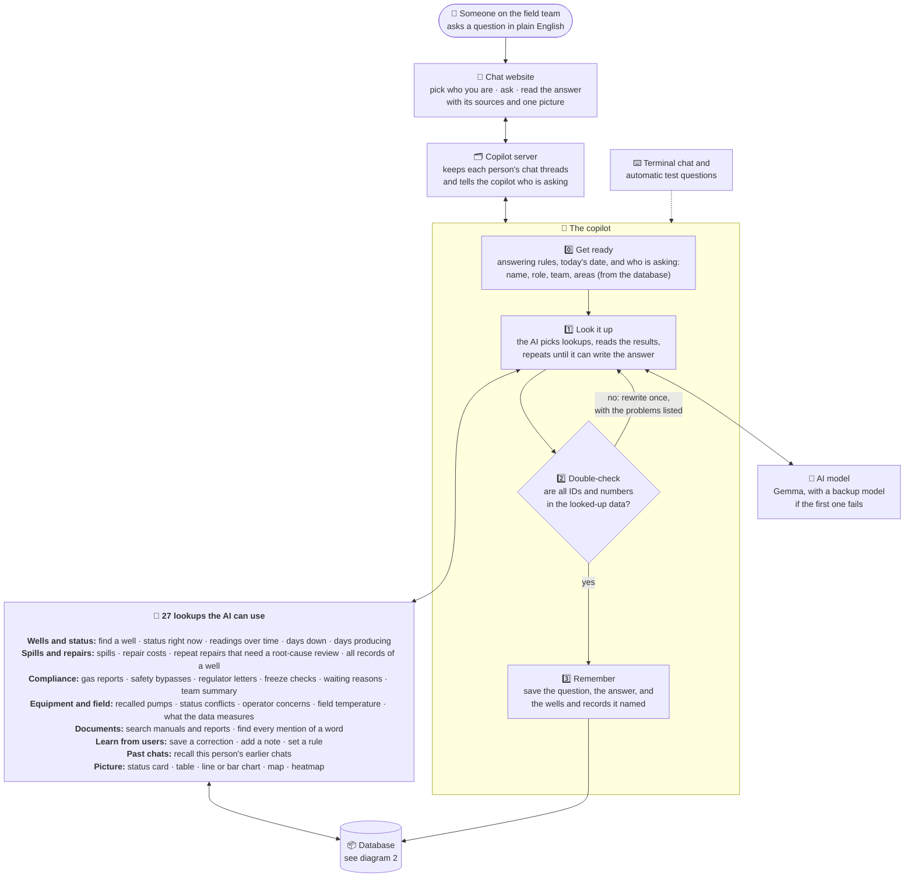
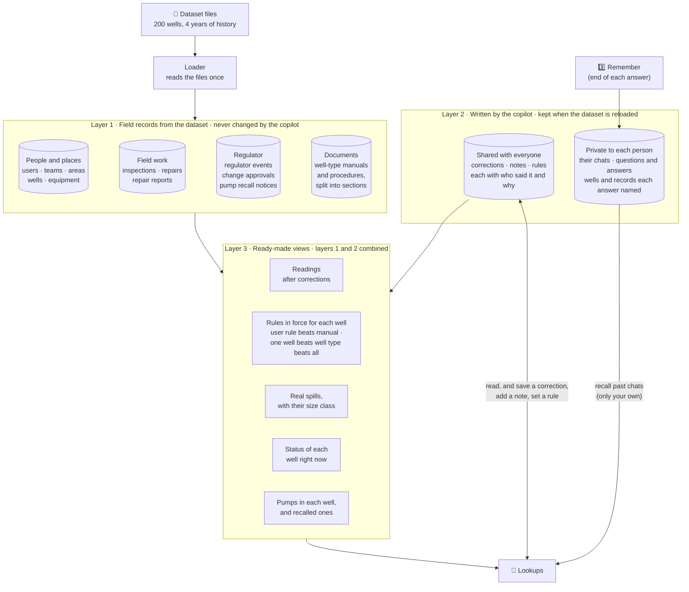

# How the copilot works

A person asks a question on the website. The AI looks up the answer in the field database, the
copilot checks every ID and number against what it looked up, and the person gets an answer with
its sources and one picture.

## 1. How a question gets answered

## 2. What's in the database

One file, in three layers. The copilot never changes the dataset records. What people tell it is
kept apart, so reloading the dataset keeps it.

## Where each box is in the code

| Box | Code |
|---|---|
| Chat website | `web/` (Next.js + assistant-ui). Sends who is talking with every message. |
| Copilot server | `langgraph dev` serving `copilot/agent.py`. Lists the users for the picker (`copilot/http_app.py`). |
| 0️⃣ Get ready | `copilot/prompt.py` |
| 1️⃣ Look it up | The ReAct agent in `copilot/agent.py` |
| 2️⃣ Double-check | `copilot/verify.py`. Plain code, not a second AI. |
| 3️⃣ Remember | `copilot/memory.py` |
| AI model | Gemma on OpenRouter, with a fallback model (`copilot/llm.py`) |
| 27 lookups | `copilot/tools/` (`status.py`, `records.py`, `compliance.py`, `assets.py`, `wells.py`, `feedback.py`, `visual.py`) and `recall_conversations` in `copilot/agent.py` |
| Database | SQLite, `data/copilot.db`. Layout in `db/schema.sql`, loader in `db/load.py` |
| Terminal chat and automatic test questions | `copilot/chat.py` and `evals/`. They call the copilot directly (`copilot.api.ask`). |
