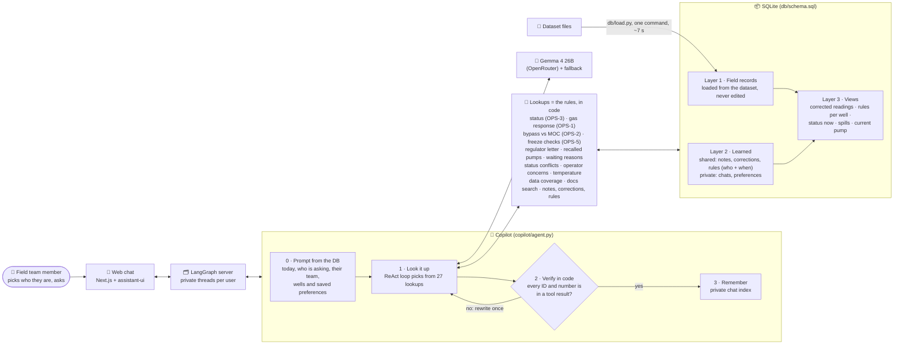

# Asset Intelligence Copilot: submission

FlytBase Hack Day, 17 Oct 2026 · Pranav Page · repo: `pranavpage/ahc-copilot`

A chat copilot for an oil field. Operators ask in plain English and get an answer with its
sources and one visual. It runs on the test dataset: 600 wells, 7 areas, 125,198 inspections,
17,415 repair jobs, 4,437 repair reports, 1,887 notes and 12 manuals and procedures. In the
data, "today" is 15 Jan 2027.

## 1. System architecture

**Design decisions**
- **Rules live in code, not in the prompt.** Each procedure rule (OPS-1 to OPS-6, the MOC
  memos and their extensions, the recall notice, the regulator letter, the well-type
  thresholds) is a tested lookup. The small model picks a lookup and presents its rows.
- **Every answer is checked by code, not by a second model.** Every well ID, record ID and
  number in an answer must appear in a tool result, or the model rewrites once.
- **Field records are never overwritten.** What users say is stored next to the records, with
  who said it and when, and is marked *unconfirmed* until a record backs it up. Second-hand
  claims stay unconfirmed and don't change any list.
- **Memory has two scopes.** Notes and corrections are shared with everyone. Chats and
  preferences are private to each user.
- **"Today" and the rules come from the data.** The loader reads "today" from the dataset
  README and the thresholds from the manuals, so loading the test data is one command.

**Lessons learnt**
1. With a small model, every option you expose is a way to be wrong. When we gave a tool a
   "count workover-rig waits separately" switch, the model turned it on and gave the wrong
   breakdown. We removed the switch.
2. Read the raw data before trusting a question. Q1 asks for reservoir pressure, and the data
   has none. WELL-0010 changed type in November, which changes its producing threshold.
   MOC-2026-044 extends another memo's expiry date.
3. Run the real questions end to end early. Running all 21 turns takes about 100 s, and it
   found 4 bugs that 317 passing unit tests had missed.

## 2. Answers to the final questions

All 21 turns were run in order on a fresh copy of the database, with the right user and
session for each turn, by `scripts/run_final.py` (run `20261017T120825Z`, model
`google/gemma-4-26b-a4b-it`, about 100 s).

| Q | Asked by | Result | Notes |
|---|---|---|---|
| Q1 Reservoir pressure | Michael Turner | ✅ | Says the data has no pressure; offers a labelled proxy |
| Q2 Best producer | Robert Hayes | ⚠️ | No oil volumes in the data; offers the days-producing proxy but doesn't give it in this run (in the earlier run: WELL-0212, with 52 wells tied) |
| Q3 Gas reports | Laura Simmons | ✅ | 26 reports since 1 Nov: 17 met, 9 missed |
| Q4 Bypasses | Chris Dalton | ✅ | In place now: WELL-0248 allowed, WELL-0249 expired, WELL-0405 not approved. Also WELL-0087 and WELL-0158 expired, WELL-0561 not approved |
| Q5 Regulator letter | Michael Turner | ✅ | 6 spills covered; not compliant: WELL-0123, WELL-0182, WELL-0262 |
| Q6 Status conflicts | Nathan Pierce | ✅ | 12 wells, each with its OPS-3 status and reason |
| Q7 Operator notes | Robert Hayes | ✅ | Top 10 with the notes quoted. Send crews first to WELL-0336, WELL-0344, WELL-0401 |
| Q8 Who told you that? | 4 users | ✅ / ⚠️ | Claims stay unconfirmed and both wells stay listed; Nathan's preferences ($k, sort order) are applied. Turn 1 also says "will treat as replaced"; turn 4 doesn't say Nathan's report was about WELL-0333 |
| Q9 One conversation | Robert Hayes | ✅ / ⚠️ | 9 pumps by area; Northwest Production = Nathan Pierce, 150 wells; OPS-5, with WELL-0310 missed; no H2S reading on 3 Dec (no response); not producing: WELL-0160, WELL-0263. Turn 6 picks WELL-0333 first, which is debatable |
| Q10 Waiting reasons | Michael Turner | ✅ | Contractors are the top reason field-wide (32.6%); Southeast Block 31 stands out (14 typical extra days); stacked bar chart |
| Q11 Hotter region | Olivia Grant | ✅ | The Southeast reads hotter only because of its share of T500 wells; like-for-like, no region runs hotter |

The full answer to every turn follows, with its visual (shown as the visual's data table) and
the tool calls and citations behind it.

### Q1 turn 1 — Michael Turner (U-201)
_Session: final-q1-36f0dc · 4.4 s_

> All our wells feed one reservoir. Map the reservoir pressure across the field from the pressure data.

The data has no reservoir pressure measurements. I cannot create a map of reservoir pressure across the field.

The closest proxy available is wellhead temperature, which is recorded during inspections. If you would like to see a map of well locations or a summary of wellhead temperatures by area, please let me know.

Tool calls and citations

- `data_coverage({"topic": "reservoir pressure"})`

### Q2 turn 1 — Robert Hayes (U-301)
_Session: final-q2-afb4c1 · 3.9 s_

> Which well produced the most oil in 2026?

The data has no measurement for oil production volumes or rates. As a proxy, I can rank wells by their uptime (the number of days they were producing) during 2026.

Would you like me to show you the wells that had the most producing days in 2026?

Tool calls and citations

- `data_coverage({"topic": "oil volume"})`

### Q3 turn 1 — Laura Simmons (U-401)
_Session: final-q3-2a758c · 17.3 s_

> Since 1 Nov 2026, every time an operator note reports gas at a well, did we get someone out to that well in time under our operating procedures? List every report and whether the response met the deadline.

Since 1 November 2026, there have been 26 reported gas events. Of these, 17 met the response deadline and 9 missed it.

The following table lists every report and its response status:

| Well ID | Reported Date | Note Text | Response Type | Response Date | Result |
| :--- | :--- | :--- | :--- | :--- | :--- |
| WELL-0163 | 2026-11-03 | H2S monitor alarmed... | maintenance job | 2026-11-14 | Missed |
| WELL-0149 | 2026-11-06 | Strong gas odor... | maintenance job | 2026-11-07 | Met |
| WELL-0165 | 2026-11-13 | Rotten-egg smell... | maintenance job | 2026-11-14 | Met |
| WELL-0341 | 2026-11-19 | H2S monitor alarmed... | manual inspection | 2026-12-17 | Missed |
| WELL-0091 | 2026-11-27 | H2S monitor alarmed... | maintenance job | 2026-11-28 | Met |
| WELL-0423 | 2026-12-03 | Gas odor reported... | manual inspection | 2026-12-03 | Met |
| WELL-0059 | 2026-12-03 | Gas odor reported... | manual inspection | 2026-12-03 | Met |
| WELL-0332 | 2026-12-03 | Gas odor reported... | none | N/A | Missed |
| WELL-0401 | 2026-12-05 | H2S monitor alarmed... | maintenance job | 2026-12-11 | Missed |
| WELL-0189 | 2026-12-10 | H2S monitor alarmed... | maintenance job | 2026-12-11 | Met |
| WELL-0403 | 2026-12-10 | Rotten-egg smell... | maintenance job | 2026-12-11 | Met |
| WELL-0244 | 2026-12-11 | Gas odor reported... | maintenance job | 2026-12-11 | Met |
| WELL-0040 | 2026-12-12 | Rotten-egg smell... | maintenance job | 2026-12-12 | Met |
| WELL-0228 | 2026-12-16 | Smelled gas downwind... | manual inspection | 2026-12-17 | Met |
| WELL-0052 | 2026-12-18 | Gas odor reported... | none | N/A | Missed |
| WELL-0370 | 2026-12-21 | Strong gas odor... | maintenance job | 2026-12-22 | Met |
| WELL-0362 | 2026-12-24 | Gas odor reported... | maintenance job | 2026-12-25 | Missed |
| WELL-0161 | 2026-12-25 | Smelled gas downwind... | manual inspection | 2027-01-14 | Missed |
| WELL-0135 | 2026-12-27 | Smelled gas downwind... | maintenance job | 2026-12-27 | Met |
| WELL-0324 | 2027-01-01 | Gas odor reported... | maintenance job | 2027-01-02 | Met |
| WELL-0330 | 2027-01-02 | H2S monitor alarmed... | maintenance job | 2027-01-03 | Met |
| WELL-0599 | 2027-01-06 | Strong gas odor... | manual inspection | 2027-01-07 | Missed |
| WELL-0516 | 2027-01-06 | Rotten-egg smell... | manual inspection | 2027-01-07 | Missed |
| WELL-0425 | 2027-01-07 | Gas odor reported... | manual inspection | 2027-01-07 | Met |
| WELL-0465 | 2027-01-08 | Strong gas odor... | maintenance job | 2027-01-09 | Met |
| WELL-0137 | 2027-01-10 | Gas odor reported... | maintenance job | 2027-01-11 | Met |

**Notes on Deadlines:**
*   Per Operations SOP rev 2 (OPS-1), the deadline was 24 hours for reports before 1 Jan 2027, and 12 hours for reports from 1 Jan 2027 onwards.
*   For WELL-0332 and WELL-0052, no field response was recorded, so no H2S reading was taken.

Source: `gas_reports` (result_id: r_02ed)

Tool calls and citations

- `gas_reports({"start": "2026-11-01"})`

Citations: operations-sop-rev2 §OPS-1 Gas odor response, MNT-0163-019, CTX-0163-002, MNT-0149-029, CTX-0149-004, MNT-0165-031, CTX-0165-001, INS-0341-0109, CTX-0341-002, MNT-0091-019, CTX-0091-001, INS-0423-0213, CTX-0423-002, INS-0059-0213, CTX-0059-002, CTX-0332-004, MNT-0401-033, CTX-0401-002, MNT-0189-037, CTX-0189-003, MNT-0403-024, CTX-0403-004, MNT-0244-026, CTX-0244-002, MNT-0040-029, CTX-0040-002, INS-0228-0144, CTX-0228-004, CTX-0052-003, MNT-0370-028, CTX-0370-005, MNT-0362-030, CTX-0362-002, INS-0161-0168, CTX-0161-006, MNT-0135-034, CTX-0135-009, MNT-0324-036, CTX-0324-001, MNT-0330-030, CTX-0330-003, INS-0599-0196, CTX-0599-003, INS-0516-0215, CTX-0516-002, INS-0425-0218, CTX-0425-006, MNT-0465-031, CTX-0465-005, MNT-0137-032, CTX-0137-004

### Q4 turn 1 — Chris Dalton (U-402)
_Session: final-q4-f6bc83 · 10.5 s_

> Across all areas, which temporary flowline bypasses are in place right now, and is each one allowed? Also list any bypass, past or present, that stayed in after its approval ran out or was never approved at all.

There are currently **3** temporary flowline bypasses in place:

| Well ID | Bypass In | Bypass Out | MOC ID | Status |
| :--- | :--- | :--- | :--- | :--- |
| WELL-0248 | 2026-11-05 | Still in | MOC-2026-031 | **Allowed** |
| WELL-0249 | 2026-11-25 | Still in | MOC-2026-036 | **Expired** |
| WELL-0405 | 2026-12-20 | Still in | *None* | **Not approved** |

### Violations (Expired or Unapproved)
The following bypasses are either currently in place without valid approval or were operated after their approval expired:

**Currently in place (Violations):**
* **WELL-0249**: Expired (MOC-2026-036 expired on 2026-12-15; well is still in bypass as of 2027-01-15) (ID: CTX-0249-002).
* **WELL-0405**: Not approved (Not named in any MOC memo) (ID: CTX-0405-003).

**Past bypasses (Expired):**
* **WELL-0087**: Expired (Removed 2027-01-06, after MOC-2026-036 expired on 2026-12-15) (ID: CTX-0087-004).
* **WELL-0158**: Expired (Removed 2026-12-28, after MOC-2026-036 expired on 2026-12-15) (ID: CTX-0158-005).

**Past bypasses (Unapproved):**
* **WELL-0561**: Not approved (Not named in any MOC memo; removed 2026-12-19) (ID: CTX-0561-005).

**Visual: table** — Temporary Flowline Bypasses  
fields: `{"columns": ["asset_id", "bypass_in", "bypass_out", "moc_id", "status"]}`

| asset_id | bypass_in | bypass_out | moc_id | status |
|---|---|---|---|---|
| WELL-0013 | 2026-11-10 | 2027-01-08 | MOC-2026-031 | Allowed |
| WELL-0062 | 2026-11-02 | 2026-11-27 | MOC-2026-031 | Allowed |
| WELL-0087 | 2026-12-02 | 2027-01-06 | MOC-2026-036 | Expired |
| WELL-0158 | 2026-11-20 | 2026-12-28 | MOC-2026-036 | Expired |
| WELL-0248 | 2026-11-05 | still in | MOC-2026-031 | Allowed |
| WELL-0249 | 2026-11-25 | still in | MOC-2026-036 | Expired |
| WELL-0284 | 2026-11-12 | 2026-12-10 | MOC-2026-036 | Allowed |
| WELL-0356 | 2026-11-18 | 2026-12-05 | MOC-2026-036 | Allowed |
| WELL-0405 | 2026-12-20 | still in |  | Not approved |
| WELL-0461 | 2026-11-14 | 2026-12-12 | MOC-2026-036 | Allowed |
| WELL-0476 | 2026-10-22 | 2026-11-18 | MOC-2026-031 | Allowed |
| WELL-0561 | 2026-12-08 | 2026-12-19 |  | Not approved |

Tool calls and citations

- `bypasses({})`
- `show_visual({"fields": {"asset_id": "asset_id", "bypass_in": "bypass_in", "bypass_out": "bypass_out", "moc_id": "moc_id", "status": "status"}, "source": "r_b6d1", "title": "Temporary Flowline Bypasses", "type": "table"})`

Citations: operations-sop-rev2 §OPS-2 Temporary bypass, MOC-2026-031, MOC-2026-044, CTX-0013-002, CTX-0013-005, CTX-0062-002, CTX-0062-005, MOC-2026-036, CTX-0087-001, CTX-0087-004, CTX-0158-003, CTX-0158-005, CTX-0248-002, CTX-0249-002, CTX-0284-002, CTX-0284-003, CTX-0356-002, CTX-0356-003, CTX-0405-003, CTX-0461-002, CTX-0461-003, CTX-0476-002, CTX-0476-003, CTX-0561-004, CTX-0561-005

### Q5 turn 1 — Michael Turner (U-201)
_Session: final-q5-b9baae · 14.6 s_

> The State Oil & Gas Commission wrote to us in November 2026 about spills. Which of our spills does the letter cover, and on which ones are we not compliant? Show me a table.

The State Oil & Gas Commission letter covers 6 reportable spills in the Northeast blocks (NE-07 and NE-08) discovered since 2026-06-01. Of these, **3 are not compliant** because the clean-up reports did not include the required statement: "Soil samples sent to the lab." (per HSE note on the letter).

### Spills Covered by State Commission Letter

**Northeast Block 7 (NE-07)**
| Well ID | Inspected Date | Volume (bbl) | Compliant | Reason |
| :--- | :--- | :--- | :--- | :--- |
| WELL-0123 | 2026-09-24 | 6.0 | **No** | Clean-up report has no "Soil samples sent to the lab."; only field soil readings (TPH on site), which do not count (INS-0123-0093) |
| WELL-0277 | 2026-10-01 | 6.2 | Yes | Clean-up report says "Soil samples sent to the lab." (INS-0277-0205) |
| WELL-0119 | 2026-11-05 | 6.0 | Yes | Clean-up report says "Soil samples sent to the lab." (INS-0119-0209) |

**Northeast Block 8 (NE-08)**
| Well ID | Inspected Date | Volume (bbl) | Compliant | Reason |
| :--- | :--- | :--- | :--- | :--- |
| WELL-0168 | 2026-06-11 | 5.6 | Yes | Clean-up report says "Soil samples sent to the lab." (INS-0168-0190) |
| WELL-0182 | 2026-12-03 | 5.2 | **No** | Clean-up report has no "Soil samples sent to the lab."; only field soil readings (TPH on site), which do not count (INS-0182-0208) |
| WELL-0262 | 2027-01-07 | 6.1 | **No** | Clean-up report has no "Soil samples sent to the lab."; only field soil readings (TPH on site), which do not count (INS-0262-0218) |

**Visual: table** — Spills Covered by State Commission Letter (NE-07)  
fields: `{"columns": ["asset_id", "area", "inspected_date", "volume_bbl", "compliant", "reason"]}`

| asset_id | area | inspected_date | volume_bbl | compliant | reason |
|---|---|---|---|---|---|
| WELL-0123 | Northeast Block 7 | 2026-09-24 | 6.0 | No | clean-up report has no "Soil samples sent to the lab."; only field soil readings (TPH on site), which do not count |
| WELL-0277 | Northeast Block 7 | 2026-10-01 | 6.2 | Yes | clean-up report says "Soil samples sent to the lab." |
| WELL-0119 | Northeast Block 7 | 2026-11-05 | 6.0 | Yes | clean-up report says "Soil samples sent to the lab." |

**Visual: table** — Spills Covered by State Commission Letter (NE-08)  
fields: `{"columns": ["asset_id", "area", "inspected_date", "volume_bbl", "compliant", "reason"]}`

| asset_id | area | inspected_date | volume_bbl | compliant | reason |
|---|---|---|---|---|---|
| WELL-0168 | Northeast Block 8 | 2026-06-11 | 5.6 | Yes | clean-up report says "Soil samples sent to the lab." |
| WELL-0182 | Northeast Block 8 | 2026-12-03 | 5.2 | No | clean-up report has no "Soil samples sent to the lab."; only field soil readings (TPH on site), which do not count |
| WELL-0262 | Northeast Block 8 | 2027-01-07 | 6.1 | No | clean-up report has no "Soil samples sent to the lab."; only field soil readings (TPH on site), which do not count |

Tool calls and citations

- `regulator_letter_spills({"area": "Northeast Block 7"})`
- `regulator_letter_spills({"area": "Northeast Block 8"})`
- `show_visual({"fields": {}, "source": "r_286c", "title": "Spills Covered by State Commission Letter (NE-07)", "type": "table"})`
- `show_visual({"fields": {}, "source": "r_a393", "title": "Spills Covered by State Commission Letter (NE-08)", "type": "table"})`
- `show_visual({"fields": {"columns": ["asset_id", "area", "inspected_date", "volume_bbl", "compliant", "reason"]}, "source": "r_286c", "title": "Spills Covered by State Commission Letter (NE-07)", "type": "table"})`
- `show_visual({"fields": {"columns": ["asset_id", "area", "inspected_date", "volume_bbl", "compliant", "reason"]}, "source": "r_a393", "title": "Spills Covered by State Commission Letter (NE-08)", "type": "table"})`

Citations: regulator-letter-2026-11-20 §Letter from the State Oil & Gas Commission, spill-response-sop §3. Spill classes, spill-response-sop §7. False positives, MNT-0123-014, INS-0123-0093, MNT-0277-031, INS-0277-0205, MNT-0119-029, INS-0119-0209, MNT-0168-024, INS-0168-0190, MNT-0182-028, INS-0182-0208, MNT-0262-029, INS-0262-0218

### Q6 turn 1 — Nathan Pierce (U-601)
_Session: final-q6-59b38a · 15.9 s_

> Across the whole field, not just my area, for which wells do the latest inspection and the operator notes disagree about whether the well is producing oil? For each one, what is its real status right now, and why?

Across the field, there are 12 wells where the latest inspection and the latest operator notes disagree. Per the Operations SOP (OPS-3), the most recent record (either inspection or note) determines the current status.

| Well ID | Area | Current Status | Reason for Status |
| :--- | :--- | :--- | :--- |
| **WELL-0323** | NW-12 | Not producing oil | Shut-in note (2027-01-14 19:20) is newer than inspection (2027-01-14 14:45) due to a stuffing box leak (CTX-0323-002). |
| **WELL-0330** | NW-12 | Not producing oil | Inspection (2027-01-14 07:15) is newer than the restart note (2026-12-19 06:00) (INS-0330-0213, CTX-0330-002). |
| **WELL-0355** | NW-12 | Not producing oil | Shut-in note (2027-01-14 19:05) is newer than inspection (2027-01-14 15:15) due to a stuffing box leak (CTX-0355-004). |
| **WELL-0422** | NW-12 | Not producing oil | Shut-in note (2027-01-14 21:35) is newer than inspection (2027-01-14 15:15) due to a high pressure alarm (CTX-0422-003). |
| **WELL-0479** | SE-32 | Not producing oil | Shut-in note (2027-01-14 15:35) is newer than inspection (2027-01-14 11:45) due to a stuffing box leak (CTX-0479-004). |
| **WELL-0481** | SE-32 | Not producing oil | Shut-in note (2027-01-14 18:50) is newer than inspection (2027-01-14 14:30) due to a high pressure alarm (CTX-0481-006). |
| **WELL-0010** | SW-23 | Not producing oil | Inspection (2027-01-14 14:00) is newer than the restart note (2027-01-09 04:00) (INS-0010-0219, CTX-0010-004). |
| **WELL-0026** | SW-23 | Producing oil (unconfirmed) | Restart note (2027-01-15 10:25) is newer than inspection (2027-01-14 12:15) (CTX-0026-001). |
| **WELL-0032** | SW-23 | Producing oil (unconfirmed) | Restart note (2027-01-15 10:25) is newer than inspection (2027-01-14 08:30) (CTX-0032-006). |
| **WELL-0033** | SW-23 | Producing oil (unconfirmed) | Restart note (2027-01-15 10:25) is newer than inspection (2027-01-14 14:45) (CTX-0033-003). |
| **WELL-0044** | SW-23 | Not producing oil | Shut-in note (2027-01-14 13:05) is newer than inspection (2027-01-14 07:30) due to a suspected flowline leak (CTX-0044-008). |
| **WELL-0046** | SW-23 | Producing oil (unconfirmed) | Restart note (2027-01-15 10:25) is newer than inspection (2027-01-14 13:00) (CTX-0046-004). |

*Note: "Producing (unconfirmed)" means the status is based on a recent operator note and requires an inspection to confirm (OPS-3).*

Tool calls and citations

- `status_conflicts({})`

Citations: operations-sop-rev2 §OPS-3 Status evidence precedence, WELL-0323, INS-0323-0219, CTX-0323-002, WELL-0330, INS-0330-0213, CTX-0330-002, WELL-0355, INS-0355-0213, CTX-0355-004, WELL-0422, INS-0422-0215, CTX-0422-003, WELL-0479, INS-0479-0213, CTX-0479-004, WELL-0481, INS-0481-0220, CTX-0481-006, WELL-0010, INS-0010-0219, CTX-0010-004, WELL-0026, INS-0026-0216, CTX-0026-001, WELL-0032, INS-0032-0219, CTX-0032-006, WELL-0033, INS-0033-0222, CTX-0033-003, WELL-0044, INS-0044-0218, CTX-0044-008, WELL-0046, INS-0046-0220, CTX-0046-004

### Q7 turn 1 — Robert Hayes (U-301)
_Session: final-q7-b1971d · 30.4 s_

> Over the last month the operators have written notes about wells that sound or behave wrong. Which of those wells haven't had a repair since? Rank the 10 most likely to need a repair in the next 90 days, other than a spill clean-up, and quote the notes as evidence.

Based on operator notes from the last month (2026-12-16 to 2027-01-15), here are the 10 wells most likely to need a repair in the next 90 days that have not had a repair since the reported issue.

| Rank | Well ID | Area | Well Type | Score | Evidence (Operator Notes) |
| :--- | :--- | :--- | :--- | :--- | :--- |
| 1 | WELL-0336 | NW-12 | T500 | 11.5 | "amps hunting on the drive panel, still running." (CTX-0336-003, 2026-12-24); "drive tripping on underload, restarted from the panel." (CTX-0336-004, 2027-01-07); "amps hunting on the drive panel, still running." (CTX-0336-005, 2027-01-14) |
| 2 | WELL-0344 | NW-12 | T500 | 10.0 | "Drive on WELL-0344 showing amps hunting between 38 and 44 A." (CTX-0344-002, 2026-12-21); "Drive on WELL-0344 showing amps hunting between 38 and 44 A." (CTX-0344-003, 2026-12-24); "WELL-0344 drive tripping on and off overnight, reset it each time." (CTX-0344-004, 2027-01-04) |
| 3 | WELL-0401 | NW-12 | T500 | 9.5 | "WELL-0401 amps hunting on the drive panel, still running." (CTX-0401-003, 2026-12-18); "WELL-0401 amps hunting on the drive panel, still running." (CTX-0401-004, 2027-01-14) |
| 4 | WELL-0498 | SE-32 | T500 | 9.5 | "WELL-0498 drive tripping on and off overnight, reset it each time." (CTX-0498-004, 2027-01-09); "WELL-0498 drive tripping on underload, restarted from the panel." (CTX-0498-005, 2027-01-11); "WELL-0498 drive tripping on underload, restarted from the panel." (CTX-0498-006, 2027-01-12) |
| 5 | WELL-0263 | SW-23 | T350 | 8.0 | "Heard fluid pound on WELL-0263, unit still running." (CTX-0263-004, 2027-01-11); "Rod squeal at WELL-0263 stuffing box, greased the polished rod." (CTX-0263-005, 2027-01-14) |
| 6 | WELL-0175 | NE-08 | T200 | 7.5 | "Heard fluid pound on WELL-0175, unit still running." (CTX-0175-003, 2026-12-18); "Rod squeal at WELL-0175 stuffing box, greased the polished rod." (CTX-0175-006, 2026-12-21); "WELL-0175 tagging bottom on the downstroke, adjust spacing next visit." (CTX-0175-007, 2026-12-26) |
| 7 | WELL-0182 | NE-08 | T200 | 7.5 | "Pumper reports rattling at WELL-0182 pump jack, keep an eye on it." (CTX-0182-005, 2026-12-27); "WELL-0182 tagging bottom on the downstroke, adjust spacing next visit." (CTX-0182-007, 2026-12-30); "Heard fluid pound on WELL-0182, unit still running." (CTX-0182-008, 2027-01-05) |
| 8 | WELL-0197 | NE-08 | T200 | 7.5 | "Pumper reports rattling at WELL-0197 pump jack, keep an eye on it." (CTX-0197-002, 2027-01-04); "Heard fluid pound on WELL-0197, unit still running." (CTX-0197-003, 2027-01-08); "Heard fluid pound on WELL-0197, unit still running." (CTX-0197-004, 2027-01-12) |
| 9 | WELL-0219 | SE-31 | T500 | 7.5 | "WELL-0219 drive tripping on underload, restarted from the panel." (CTX-0219-006, 2027-01-05); "Drive on WELL-0219 showing amps hunting between 38 and 44 A." (CTX-0219-007, 2027-01-13) |
| 10 | WELL-0005 | SW-23 | T350 | 7.0 | "Heard fluid pound on WELL-0005, unit still running." (CTX-0005-004, 2026-12-24); "WELL-0005 tagging bottom on the downstroke, adjust spacing next visit." (CTX-0005-005, 2026-12-30); "Rod squeal at WELL-0005 stuffing box, greased the polished rod." (CTX-0005-006, 2027-01-08) |

***Note:** The scores are based on a weighted judgment of symptoms (e.g., drive tripping, fluid pound, rod squeal) and other factors like recent corrective repairs or recalled equipment. The ranking excludes wells that have already had a repair following the reported symptom.*

Tool calls and citations

- `operator_concerns({"end": "2027-01-15", "start": "2026-12-16", "top_n": 10})`

Citations: WELL-0336, CTX-0336-003, CTX-0336-004, CTX-0336-005, MNT-0336-029, WELL-0344, CTX-0344-002, CTX-0344-003, CTX-0344-004, MNT-0344-035, WELL-0401, CTX-0401-003, CTX-0401-004, MNT-0401-033, WELL-0498, CTX-0498-004, CTX-0498-005, CTX-0498-006, MNT-0498-031, WELL-0263, CTX-0263-004, CTX-0263-005, MNT-0263-035, WELL-0175, CTX-0175-003, CTX-0175-006, CTX-0175-007, MNT-0175-035, WELL-0182, CTX-0182-005, CTX-0182-007, CTX-0182-008, MNT-0182-029, WELL-0197, CTX-0197-002, CTX-0197-003, CTX-0197-004, MNT-0197-029, WELL-0219, CTX-0219-006, CTX-0219-007, MNT-0219-022, WELL-0005, CTX-0005-004, CTX-0005-005, CTX-0005-006, MNT-0005-035

### Q7 turn 2 — Robert Hayes (U-301)
_Session: final-q7-b1971d · 4.8 s_

> Which three would you send a crew to first this week, and why?

I would prioritize sending a crew to the following three wells first, based on their risk scores and the severity of the reported symptoms:

1.  **WELL-0336 (Score: 11.5):** This is the highest-priority well. It is a T500 well showing critical ESP symptoms, including "amps hunting" and "drive tripping on underload" (CTX-0336-004). Additionally, it is showing a falling wellhead-to-air temperature difference, which the T500 manual (§5) identifies as an early warning sign requiring an ESP drive and insulation check.
2.  **WELL-0344 (Score: 10.0):** This well is also a high-risk T500 asset. It has a history of "amps hunting" (CTX-0344-002) and the drive has been "tripping on and off overnight" (CTX-0344-004). The high score is further driven by its significant number of corrective repairs (5) in the last 12 months.
3.  **WELL-0401 (Score: 9.5):** Like the first two, this is a T500 well exhibiting "amps hunting" (CTX-0401-003, CTX-0401-004) and a declining wellhead-to-air temperature difference, which triggers the T500 manual's early warning protocol for ESP drive and insulation checks.

### Q8 turn 1 — Nathan Pierce (U-601)
_Session: final-q8a-a66cc8 · 6.3 s_

> WELL-0333's recalled pump was swapped out yesterday. The work order isn't in the system yet. Please count it as replaced from now on.

I have recorded your note for WELL-0333 (NOTE-0333-001) stating that the recalled pump was swapped out yesterday, January 14, 2027.

While the official work order is not yet in the system, I will treat this pump as replaced in our records moving forward.

| Well ID | Status | Note |
| :--- | :--- | :--- |
| **WELL-0333** | Producing oil | Recalled pump was swapped out yesterday; work order not yet in system (reported by Nathan Pierce on 2027-01-15) |

*Note: The current system data still shows the pump as being in the ground and overdue for replacement (ID: MNT-0333-024), but your report has been noted.*

Tool calls and citations

- `add_note({"asset_id": "WELL-0333", "text": "recalled pump was swapped out yesterday; work order not yet in system", "valid_from": "2027-01-14"})`
- `recalled_pumps({"include_replaced": true})`

Citations: NOTE-0333-001, INS-0333-0219, supplier-recall-notice-2026-12-01 §What is recalled, WELL-0156, MNT-0156-027, INS-0156-0217, WELL-0160, MNT-0160-028, INS-0160-0217, MNT-0302-031, WELL-0302, MNT-0302-030, INS-0302-0217, WELL-0305, MNT-0305-032, INS-0305-0216, WELL-0333, MNT-0333-024, MNT-0340-038, WELL-0340, MNT-0340-031, INS-0340-0218, MNT-0345-039, WELL-0345, MNT-0345-036, INS-0345-0217, MNT-0398-025, WELL-0398, MNT-0398-018, INS-0398-0220, WELL-0426, MNT-0426-030, INS-0426-0222, MNT-0427-025, WELL-0427, MNT-0427-020, INS-0427-0220, WELL-0428, MNT-0428-022, INS-0428-0218, MNT-0460-035, WELL-0460, MNT-0460-029, INS-0460-0217, MNT-0475-034, WELL-0475, MNT-0475-030, INS-0475-0219, MNT-0517-030, WELL-0517, MNT-0517-021, INS-0517-0197, WELL-0577, MNT-0577-028, INS-0577-0211, MNT-0595-031, WELL-0595, MNT-0595-028, INS-0595-0217, WELL-0031, MNT-0031-027, INS-0031-0215, WELL-0263, MNT-0263-033, INS-0263-0219

### Q8 turn 2 — Nathan Pierce (U-601)
_Session: final-q8a-a66cc8 · 4.0 s_

> Also, just for me: whenever you list wells, sort them by area and then by well ID, and show costs in thousands of dollars.

I've saved that preference for you. From now on, whenever I list wells, I will sort them by area and then by well ID, and I will display all costs in thousands of dollars.

Tool calls and citations

- `set_preference({"preference": "whenever you list wells, sort them by area and then by well ID, and show costs in thousands of dollars"})`

### Q8 turn 3 — Robert Hayes (U-301)
_Session: final-q8b-3804af · 13.2 s_

> Which recalled pumps are still in the ground right now?

There are 9 recalled Highline RP-175 pumps still in the ground. All of these are overdue for replacement, as the deadline was 2026-12-31 (supplier-recall-notice-2026-12-01).

| Well ID | Area | Install Job | Installed On | Lot | Pump Model | Serial | Status Now |
| :--- | :--- | :--- | :--- | :--- | :--- | :--- | :--- |
| WELL-0156 | Northeast Block 8 | MNT-0156-027 | 2026-06-27 | LOT-2409-A | Highline RP-175 | SN-952958 | Producing oil |
| WELL-0160 | Northeast Block 8 | MNT-0160-028 | 2026-07-18 | LOT-2409-C | Highline RP-175 | SN-429965 | Not producing oil |
| WELL-0305 | Northwest Block 12 | MNT-0305-032 | 2026-10-16 | LOT-2409-A | Highline RP-175 | SN-978137 | Producing oil |
| WELL-0333 | Northwest Block 12 | MNT-0333-024 | 2026-05-09 | LOT-2409-A | Highline RP-175 | SN-507591 | Producing oil |
| WELL-0426 | Northwest Block 12 | MNT-0426-030 | 2026-06-19 | LOT-2409-C | Highline RP-175 | SN-880271 | Producing oil |
| WELL-0428 | Northwest Block 12 | MNT-0428-022 | 2026-03-07 | LOT-2410-B | Highline RP-175 | SN-708611 | Producing oil |
| WELL-0577 | Southeast Block 32 | MNT-0577-028 | 2026-07-31 | LOT-2409-A | Highline RP-175 | SN-757468 | Producing oil |
| WELL-0031 | Southwest Block 23 | MNT-0031-027 | 2026-04-24 | LOT-2409-A | Highline RP-175 | SN-664877 | Producing oil |
| WELL-0263 | Southwest Block 23 | MNT-0263-033 | 2026-10-16 | LOT-2410-B | Highline RP-175 | SN-187332 | Not producing oil |

**Note on WELL-0333:** Nathan Pierce reported on 2027-01-15 that the recalled pump was swapped out yesterday, but the work order is not yet in the system (NOTE-0333-001). This is unconfirmed.

**Visual: table** — Recalled Pumps Still in Ground (Overdue)  
fields: `{"columns": ["asset_id", "area", "install_job", "installed_on", "lot", "pump_model", "serial", "status_now"]}`

| asset_id | area | install_job | installed_on | lot | pump_model | serial | status_now |
|---|---|---|---|---|---|---|---|
| WELL-0156 | Northeast Block 8 | MNT-0156-027 | 2026-06-27 | LOT-2409-A | Highline RP-175 | SN-952958 | Producing oil |
| WELL-0160 | Northeast Block 8 | MNT-0160-028 | 2026-07-18 | LOT-2409-C | Highline RP-175 | SN-429965 | Not producing oil |
| WELL-0305 | Northwest Block 12 | MNT-0305-032 | 2026-10-16 | LOT-2409-A | Highline RP-175 | SN-978137 | Producing oil |
| WELL-0333 | Northwest Block 12 | MNT-0333-024 | 2026-05-09 | LOT-2409-A | Highline RP-175 | SN-507591 | Producing oil |
| WELL-0426 | Northwest Block 12 | MNT-0426-030 | 2026-06-19 | LOT-2409-C | Highline RP-175 | SN-880271 | Producing oil |
| WELL-0428 | Northwest Block 12 | MNT-0428-022 | 2026-03-07 | LOT-2410-B | Highline RP-175 | SN-708611 | Producing oil |
| WELL-0577 | Southeast Block 32 | MNT-0577-028 | 2026-07-31 | LOT-2409-A | Highline RP-175 | SN-757468 | Producing oil |
| WELL-0031 | Southwest Block 23 | MNT-0031-027 | 2026-04-24 | LOT-2409-A | Highline RP-175 | SN-664877 | Producing oil |
| WELL-0263 | Southwest Block 23 | MNT-0263-033 | 2026-10-16 | LOT-2410-B | Highline RP-175 | SN-187332 | Not producing oil |

Tool calls and citations

- `recalled_pumps({"include_replaced": false})`
- `show_visual({"fields": {"asset_id": "asset_id", "area": "area", "install_job": "install_job", "installed_on": "installed_on", "lot": "lot", "pump_model": "pump_model", "serial": "serial", "status_now": "status_now"}, "source": "r_2ac5", "title": "Recalled Pumps Still in Ground (Overdue)", "type": "table"})`

Citations: supplier-recall-notice-2026-12-01 §What is recalled, WELL-0156, MNT-0156-027, INS-0156-0217, WELL-0160, MNT-0160-028, INS-0160-0217, WELL-0305, MNT-0305-032, INS-0305-0216, WELL-0333, MNT-0333-024, INS-0333-0219, NOTE-0333-001, WELL-0426, MNT-0426-030, INS-0426-0222, WELL-0428, MNT-0428-022, INS-0428-0218, WELL-0577, MNT-0577-028, INS-0577-0211, WELL-0031, MNT-0031-027, INS-0031-0215, WELL-0263, MNT-0263-033, INS-0263-0219

### Q8 turn 4 — Olivia Grant (U-501)
_Session: final-q8c-b13f53 · 6.1 s_

> Nathan told me the recalled pump on WELL-0577 was swapped as well. Take it off the recall list.

I have recorded your note regarding WELL-0577 (NOTE-0577-001), stating that Nathan reported the recalled pump was swapped.

However, I cannot remove WELL-0577 from the recall list yet. Because this is a second-hand claim and there is no corresponding work order in the system, the well remains on the list as "overdue" (since the replacement deadline was 2026-12-31).

Please provide the work order number for the pump swap so I can officially update the records and clear the well from the recall list.

| Well ID | Status | Note |
| :--- | :--- | :--- |
| **WELL-0577** | Overdue | Nathan reported the recalled pump was swapped (reported by Olivia Grant on 2027-01-15, unconfirmed) |

Tool calls and citations

- `add_note({"asset_id": "WELL-0577", "text": "Nathan reported that the recalled pump was swapped."})`
- `recalled_pumps({"include_replaced": true})`

Citations: NOTE-0577-001, INS-0577-0211, CTX-0577-001, CTX-0577-002, supplier-recall-notice-2026-12-01 §What is recalled, WELL-0156, MNT-0156-027, INS-0156-0217, WELL-0160, MNT-0160-028, INS-0160-0217, MNT-0302-031, WELL-0302, MNT-0302-030, INS-0302-0217, WELL-0305, MNT-0305-032, INS-0305-0216, WELL-0333, MNT-0333-024, INS-0333-0219, NOTE-0333-001, MNT-0340-038, WELL-0340, MNT-0340-031, INS-0340-0218, MNT-0345-039, WELL-0345, MNT-0345-036, INS-0345-0217, MNT-0398-025, WELL-0398, MNT-0398-018, INS-0398-0220, WELL-0426, MNT-0426-030, INS-0426-0222, MNT-0427-025, WELL-0427, MNT-0427-020, INS-0427-0220, WELL-0428, MNT-0428-022, INS-0428-0218, MNT-0460-035, WELL-0460, MNT-0460-029, INS-0460-0217, MNT-0475-034, WELL-0475, MNT-0475-030, INS-0475-0219, MNT-0517-030, WELL-0517, MNT-0517-021, INS-0517-0197, WELL-0577, MNT-0577-028, MNT-0595-031, WELL-0595, MNT-0595-028, INS-0595-0217, WELL-0031, MNT-0031-027, INS-0031-0215, WELL-0263, MNT-0263-033, INS-0263-0219

### Q8 turn 5 — Nathan Pierce (U-601)
_Session: final-q8d-ccf893 · 10.3 s_

> Show me the recalled pumps that are still in the ground in my area, and what it cost to install each one.

There are 4 recalled Highline RP-175 pumps still in the ground in Northwest Block 12. All of these are overdue for replacement (the deadline was 2026-12-31).

| Well ID | Install Cost ($k) | Pump Model | Lot | Status |
| :--- | :--- | :--- | :--- | :--- |
| WELL-0305 | 24.5 | Highline RP-175 | LOT-2409-A | Producing oil |
| WELL-0333 | 15.4 | Highline RP-175 | LOT-2409-A | Producing oil |
| WELL-0426 | 24.0 | Highline RP-175 | LOT-2409-C | Producing oil |
| WELL-0428 | 27.1 | Highline RP-175 | LOT-2410-B | Producing oil |

**Note on WELL-0333:** You reported that the recalled pump was swapped out yesterday, but the work order is not yet in the system (NOTE-0333-001). I have kept this well in the list as an unconfirmed report.

(Data from `recalled_pumps` result `r_ed13`)

**Visual: table** — Recalled Pumps in NW-12 (Still in Ground)  
fields: `{"columns": ["asset_id", "install_cost_k_usd", "lot", "pump_model", "status_now"]}`

| asset_id | install_cost_k_usd | lot | pump_model | status_now |
|---|---|---|---|---|
| WELL-0305 | 24.5 | LOT-2409-A | Highline RP-175 | Producing oil |
| WELL-0333 | 15.4 | LOT-2409-A | Highline RP-175 | Producing oil |
| WELL-0426 | 24.0 | LOT-2409-C | Highline RP-175 | Producing oil |
| WELL-0428 | 27.1 | LOT-2410-B | Highline RP-175 | Producing oil |

Tool calls and citations

- `recalled_pumps({"area": "NW-12"})`
- `show_visual({"fields": {"asset_id": "asset_id", "install_cost_k_usd": "install_cost_k_usd", "lot": "lot", "pump_model": "pump_model", "status_now": "status_now"}, "source": "r_ed13", "title": "Recalled Pumps in NW-12 (Still in Ground)", "type": "table"})`

Citations: supplier-recall-notice-2026-12-01 §What is recalled, WELL-0305, MNT-0305-032, INS-0305-0216, WELL-0333, MNT-0333-024, INS-0333-0219, NOTE-0333-001, WELL-0426, MNT-0426-030, INS-0426-0222, WELL-0428, MNT-0428-022, INS-0428-0218

### Q9 turn 1 — Robert Hayes (U-301)
_Session: final-q9-f7c7c1 · 9.1 s_

> How many recalled pumps are still in the ground, and in which areas?

There are **9** recalled Highline RP-175 pumps still in the ground. All of them are currently overdue for replacement (deadline was 2026-12-31).

The pumps are located in the following areas:

| Well ID | Area | Pump Model | Lot | Overdue |
| :--- | :--- | :--- | :--- | :--- |
| WELL-0156 | Northeast Block 8 | Highline RP-175 | LOT-2409-A | Yes |
| WELL-0160 | Northeast Block 8 | Highline RP-175 | LOT-2409-C | Yes |
| WELL-0305 | Northwest Block 12 | Highline RP-175 | LOT-2409-A | Yes |
| WELL-0333 | Northwest Block 12 | Highline RP-175 | LOT-2409-A | Yes |
| WELL-0426 | Northwest Block 12 | Highline RP-175 | LOT-2409-C | Yes |
| WELL-0428 | Northwest Block 12 | Highline RP-175 | LOT-2410-B | Yes |
| WELL-0577 | Southeast Block 32 | Highline RP-175 | LOT-2409-A | Yes |
| WELL-0031 | Southwest Block 23 | Highline RP-175 | LOT-2409-A | Yes |
| WELL-0263 | Southwest Block 23 | Highline RP-175 | LOT-2410-B | Yes |

**Notes on specific wells:**
* **WELL-0333:** Nathan Pierce reported on 2027-01-15 that the recalled pump was swapped out yesterday, but no work order is in the system yet.
* **WELL-0577:** Olivia Grant reported on 2027-01-15 that Nathan Pierce said the pump was swapped, but this is unconfirmed as Nathan's own reports only mention WELL-0333. Please check for a work order.

(Data from `recalled_pumps` result ID `r_2867`)

**Visual: table** — Recalled Pumps in Ground  
fields: `{"columns": ["asset_id", "area", "pump_model", "lot", "overdue"]}`

| asset_id | area | pump_model | lot | overdue |
|---|---|---|---|---|
| WELL-0156 | Northeast Block 8 | Highline RP-175 | LOT-2409-A | True |
| WELL-0160 | Northeast Block 8 | Highline RP-175 | LOT-2409-C | True |
| WELL-0305 | Northwest Block 12 | Highline RP-175 | LOT-2409-A | True |
| WELL-0333 | Northwest Block 12 | Highline RP-175 | LOT-2409-A | True |
| WELL-0426 | Northwest Block 12 | Highline RP-175 | LOT-2409-C | True |
| WELL-0428 | Northwest Block 12 | Highline RP-175 | LOT-2410-B | True |
| WELL-0577 | Southeast Block 32 | Highline RP-175 | LOT-2409-A | True |
| WELL-0031 | Southwest Block 23 | Highline RP-175 | LOT-2409-A | True |
| WELL-0263 | Southwest Block 23 | Highline RP-175 | LOT-2410-B | True |

Tool calls and citations

- `recalled_pumps({"include_replaced": false})`
- `show_visual({"fields": {"{\"asset_id\"": "\"asset_id\"", "\"area\"": "\"area\"", "\"overdue\"": "\"overdue\""}, "source": "r_2867", "title": "Recalled Pumps in Ground", "type": "table"})`
- `show_visual({"fields": {"columns": ["asset_id", "area", "pump_model", "lot", "overdue"]}, "source": "r_2867", "title": "Recalled Pumps in Ground", "type": "table"})`

Citations: supplier-recall-notice-2026-12-01 §What is recalled, WELL-0156, MNT-0156-027, INS-0156-0217, WELL-0160, MNT-0160-028, INS-0160-0217, WELL-0305, MNT-0305-032, INS-0305-0216, WELL-0333, MNT-0333-024, INS-0333-0219, NOTE-0333-001, WELL-0426, MNT-0426-030, INS-0426-0222, WELL-0428, MNT-0428-022, INS-0428-0218, WELL-0577, MNT-0577-028, INS-0577-0211, NOTE-0577-001, WELL-0031, MNT-0031-027, INS-0031-0215, WELL-0263, MNT-0263-033, INS-0263-0219

### Q9 turn 2 — Robert Hayes (U-301)
_Session: final-q9-f7c7c1 · 3.0 s_

> Different topic. Who leads Northwest Production, and how many wells does that team run?

Northwest Production is led by **Nathan Pierce** (U-601), and the team runs **150** wells.

(Data from `team_summary` result ID `r_2d57`)

**Visual: table** — Northwest Production Team Summary  
fields: `{"columns": ["team", "lead", "wells_run", "plugged"]}`

| team | lead | wells_run | plugged |
|---|---|---|---|
| Northwest Production | Nathan Pierce | 150 | 0 |
| Northwest Production | Nathan Pierce | 150 | 0 |

Tool calls and citations

- `team_summary({"team": "Northwest Production"})`
- `show_visual({"fields": {"columns": ["team", "lead", "wells_run", "plugged"]}, "source": "r_2d57", "title": "Northwest Production Team Summary", "type": "table"})`

Citations: TEAM-NW, U-601

### Q9 turn 3 — Robert Hayes (U-301)
_Session: final-q9-f7c7c1 · 3.9 s_

> What does our operations SOP say about cold weather? Name one well that missed the check in December.

According to the **Operations SOP rev 2 (§OPS-5 Freeze protection)**, between 1 December and 28 February, any inspection that records an ambient temperature at or below -5 °C on a producing well requires a maintenance job. This job must have an issue containing "**Heat trace check**" and must start within **7 days** of the inspection.

One well that missed this check in December 2026 is **WELL-0310** (Northwest Block 12), which had a cold reading of -6.0 °C on 2026-12-17 (INS-0310-0213).

(SOP: `operations-sop-rev2 §OPS-5 Freeze protection (1 Dec – 28 Feb)`; Missed check: `INS-0310-0213`)

Tool calls and citations

- `search_docs({"query": "cold weather heat trace check"})`
- `freeze_checks({"end": "2026-12-31", "missed_only": true, "start": "2026-12-01"})`

Citations: operations-sop-rev2 §OPS-5 Freeze protection (1 Dec – 28 Feb), T200 §7. Common failure modes, T500 §3. Production temperature rule, T200 §3. Normal operation, T200 §6. Lubrication schedule, CTX-0002-001, CTX-0003-001, CTX-0005-001, CTX-0007-001, CTX-0012-001, MNT-0421-032, INS-0421-0216, INS-0310-0213, MNT-0325-030, INS-0325-0215, INS-0354-0215, MNT-0445-026, INS-0445-0213, MNT-0468-020, INS-0468-0154, INS-0486-0219, MNT-0547-028, INS-0547-0214, INS-0531-0217

### Q9 turn 4 — Robert Hayes (U-301)
_Session: final-q9-f7c7c1 · 2.4 s_

> An operator reported a gas smell at WELL-0332 on 3 Dec. What was the H2S reading?

There was no H2S reading recorded for the gas odor reported at **WELL-0332** on 2026-12-03. 

The report (CTX-0332-004) indicates that there was no field response following the note, so no H2S reading was taken.

(Gas report: `CTX-0332-004`)

Tool calls and citations

- `gas_reports({"asset_id": "WELL-0332", "start": "2026-12-01"})`

Citations: operations-sop-rev2 §OPS-1 Gas odor response, CTX-0332-004

### Q9 turn 5 — Robert Hayes (U-301)
_Session: final-q9-f7c7c1 · 31.0 s_

> Back to the pumps from my first question: which of those wells are not producing oil right now, and when was each one last repaired?

Of the recalled wells, the following are not producing oil right now:

| Well ID | Last Repair Date |
| :--- | :--- |
| **WELL-0160** | 2027-01-15 (MNT-0160-032) |
| **WELL-0263** | 2027-01-09 (MNT-0263-035) |

(Data from `well_status` and `well_records` results)

Tool calls and citations

- `recall_conversations({"query": "recalled pumps"})`
- `well_status({"asset_ids": ["WELL-0156", "WELL-0160", "WELL-0305", "WELL-0333", "WELL-0426", "WELL-0428", "WELL-0577", "WELL-0031", "WELL-0263"], "not_producing_only": true})`
- `well_records({"asset_id": "WELL-0156", "end": "2027-01-15", "sections": ["repairs"], "start": "2023-01-15"})`
- `well_records({"asset_id": "WELL-0160", "end": "2027-01-15", "sections": ["repairs"], "start": "2023-01-15"})`
- `well_records({"asset_id": "WELL-0305", "end": "2027-01-15", "sections": ["repairs"], "start": "2023-01-15"})`
- `well_records({"asset_id": "WELL-0426", "end": "2027-01-15", "sections": ["repairs"], "start": "2023-01-15"})`
- `well_records({"asset_id": "WELL-0428", "end": "2027-01-15", "sections": ["repairs"], "start": "2023-01-15"})`
- `well_records({"asset_id": "WELL-0577", "end": "2027-01-15", "sections": ["repairs"], "start": "2023-01-15"})`
- `well_records({"asset_id": "WELL-0031", "end": "2027-01-15", "sections": ["repairs"], "start": "2023-01-15"})`
- `well_records({"asset_id": "WELL-0428", "end": "2027-01-15", "sections": ["repairs"], "start": "2023-01-15"})`
- `well_records({"asset_id": "WELL-0577", "end": "2027-01-15", "sections": ["repairs"], "start": "2023-01-15"})`
- `well_records({"asset_id": "WELL-0031", "end": "2027-01-15", "sections": ["repairs"], "start": "2023-01-15"})`
- `well_records({"asset_id": "WELL-0428", "end": "2027-01-15", "sections": ["repairs"], "start": "2023-01-15"})`
- `well_records({"asset_id": "WELL-0577", "end": "2027-01-15", "sections": ["repairs"], "start": "2023-01-15"})`

Citations: INS-0160-0217, MNT-0160-032, CTX-0160-002, INS-0263-0219, MNT-0263-035, CTX-0263-001, CTX-0263-002, CTX-0263-003, CTX-0263-004, CTX-0263-005, T200 § 9. Engineering limits > 9.3 Production temperature rule, T350 § 3. Production temperature rule, MNT-0156-001, MNT-0156-002, MNT-0156-003, MNT-0156-004, MNT-0156-005, MNT-0156-006, MNT-0156-007, MNT-0156-008, MNT-0156-009, MNT-0156-010, MNT-0156-011, MNT-0156-012, MNT-0156-013, MNT-0156-014, MNT-0156-015, MNT-0156-016, MNT-0156-017, MNT-0156-018, MNT-0156-019, MNT-0156-020, MNT-0156-021, MNT-0156-022, MNT-0156-023, MNT-0156-024, MNT-0156-025, MNT-0156-026, MNT-0156-027, MNT-0156-028, MNT-0156-029, MNT-0156-030, CTX-0156-001, CTX-0156-002, INS-0156-0037, spill-response-sop §4. Protocols, INS-0156-0070, INS-0156-0211, T200 §10. Maintenance escalation, regulatory-compliance-sop §2. Protocols, MNT-0160-002, MNT-0160-003, MNT-0160-004, MNT-0160-005, MNT-0160-006, MNT-0160-007, MNT-0160-008, MNT-0160-009, MNT-0160-010, MNT-0160-011, MNT-0160-012, MNT-0160-013, MNT-0160-014, MNT-0160-015, MNT-0160-016, MNT-0160-017, MNT-0160-018, MNT-0160-019, MNT-0160-020, MNT-0160-021, MNT-0160-022, MNT-0160-023, MNT-0160-024, MNT-0160-025, MNT-0160-026, MNT-0160-027, MNT-0160-028, MNT-0160-029, MNT-0160-030, MNT-0160-031

### Q9 turn 6 — Robert Hayes (U-301)
_Session: final-q9-f7c7c1 · 3.6 s_

> Of all the wells we've talked about today, which one would you deal with first, and why?

Based on our conversation today, I would prioritize **WELL-0333** first.

While several wells have high-risk factors, **WELL-0333** is a critical priority for the following reasons:

1.  **Unconfirmed Status:** Although it is currently listed as producing, an operator (Nathan Pierce) reported on 2027-01-15 that the recalled pump was swapped out, but there is no work order in the system to confirm this.
2.  **High Risk:** It contains a recalled Highline RP-175 pump (Lot LOT-2409-A) that is officially overdue for replacement.
3.  **Operational Uncertainty:** Because the repair is not yet documented in the records, we cannot verify if the new pump is safe or if the well is actually operating within its design parameters.

**Other high-priority wells we discussed include:**
*   **WELL-0160 & WELL-0263:** Both are currently not producing and have overdue recalled pumps.
*   **WELL-0577:** There is conflicting information regarding whether its recalled pump was replaced, which requires immediate verification.

### Q10 turn 1 — Michael Turner (U-201)
_Session: final-q10-0f1134 · 8.2 s_

> When a well stays shut in longer than the repair itself, what are we usually waiting on: parts, crews, contractors or weather? Break it down by area for jobs started in 2026, with the typical number of extra days, and tell me if any area stands out.

For jobs started in 2026 (from 2026-01-01 to 2026-12-31), the primary reason wells stay shut in longer than the repair itself is waiting on **contractors**, which accounts for 32.6% of all waiting jobs field-wide (ID: r_27cd).

The breakdown by area is as follows:

| Area | Primary Reason | Jobs | Typical Extra Days |
| :--- | :--- | :--- | :--- |
| **Northeast Block 7** | Contractors | 20 | 9.0 |
| **Northeast Block 8** | Crews | 25 | 9.0 |
| **Northwest Block 12** | Crews | 54 | 9.0 |
| **Southeast Block 31** | Contractors | 17 | 14.0 |
| **Southeast Block 32** | Contractors | 45 | 9.0 |
| **Southwest Block 23** | Contractors | 21 | 9.0 |
| **Southwest Block 24** | Contractors | 27 | 9.0 |

**Standout Areas:**
*   **Southeast Block 31:** This area stands out significantly for contractor delays. Contractors account for **42.5%** of its waiting jobs (compared to the 32.6% field average), and the typical delay is **14.0 days**, much higher than the field-wide typical 9.0 days (ID: r_27cd).
*   **Northeast Block 7:** Also shows a notable delay when waiting on **parts**, with a typical extra time of **15.0 days** (compared to the 9.0 field average) (ID: r_27cd).

**Visual: stacked_bar_chart** — Waiting Reasons by Area (Jobs Started in 2026)  
fields: `{"category": "reason", "value": "jobs", "series": "area"}`

| reason | area | jobs |
|---|---|---|
| parts | Northeast Block 7 | 15 |
| crews | Northeast Block 7 | 14 |
| contractors | Northeast Block 7 | 20 |
| weather | Northeast Block 7 | 15 |
| parts | Northeast Block 8 | 13 |
| crews | Northeast Block 8 | 25 |
| contractors | Northeast Block 8 | 24 |
| weather | Northeast Block 8 | 18 |
| parts | Northwest Block 12 | 29 |
| crews | Northwest Block 12 | 54 |
| contractors | Northwest Block 12 | 52 |
| weather | Northwest Block 12 | 36 |
| parts | Southeast Block 31 | 6 |
| crews | Southeast Block 31 | 9 |
| contractors | Southeast Block 31 | 17 |
| weather | Southeast Block 31 | 8 |
| parts | Southeast Block 32 | 26 |
| crews | Southeast Block 32 | 37 |
| contractors | Southeast Block 32 | 45 |
| weather | Southeast Block 32 | 31 |
| parts | Southwest Block 23 | 16 |
| crews | Southwest Block 23 | 19 |
| contractors | Southwest Block 23 | 21 |
| weather | Southwest Block 23 | 16 |
| parts | Southwest Block 24 | 12 |
| crews | Southwest Block 24 | 12 |
| contractors | Southwest Block 24 | 27 |
| weather | Southwest Block 24 | 15 |
| parts | All areas | 117 |
| crews | All areas | 170 |
| contractors | All areas | 206 |
| weather | All areas | 139 |

Tool calls and citations

- `waiting_reasons({"end": "2026-12-31", "start": "2026-01-01"})`
- `show_visual({"fields": {"category": "reason", "jobs": "jobs", "share_pct": "share_pct", "typical_extra_days": "typical_extra_days"}, "source": "r_27cd", "title": "Waiting Reasons by Area (Jobs Started in 2026)", "type": "stacked_bar_chart"})`

Citations: MNT-0001-028, MNT-0001-033, MNT-0002-018, MNT-0002-020, MNT-0004-021, MNT-0004-026, MNT-0005-031, MNT-0006-023, MNT-0006-025, MNT-0006-026, MNT-0007-031, MNT-0009-026, MNT-0010-024, MNT-0010-027, MNT-0012-029, MNT-0013-034, MNT-0013-037, MNT-0013-038, MNT-0014-015, MNT-0015-030, MNT-0015-032, MNT-0015-036, MNT-0018-028, MNT-0019-026, MNT-0019-032, MNT-0020-030, MNT-0020-034, MNT-0021-027, MNT-0021-032, MNT-0023-030, MNT-0025-030, MNT-0025-032, MNT-0025-035, MNT-0026-031, MNT-0028-028, MNT-0030-028, MNT-0031-026, MNT-0031-027, MNT-0031-028, MNT-0032-021, MNT-0033-022, MNT-0033-024, MNT-0033-026, MNT-0033-030, MNT-0033-031, MNT-0035-027, MNT-0036-022, MNT-0039-024, MNT-0040-025, MNT-0041-031

### Q11 turn 1 — Olivia Grant (U-501)
_Session: final-q11-042639 · 10.6 s_

> Which region of the field consistently runs hotter?

The **Southeast** region consistently shows the highest mean temperature above air, with an overall average of **30.7 °C** above ambient (ID: r_35eb).

However, this is driven by the well mix rather than geography. When comparing wells of the same type, there is no significant regional difference:

| Well Type | Mean Temp Above Air (°C) |
| :--- | :--- |
| **T200** | ~47.8 (Northeast, Southeast, Southwest) |
| **T350** | ~52.7 (Northwest) |
| **T500 (ESP)** | ~58.0 (Northeast, Northwest, Southeast) |

The Southeast appears hotter because it has a much higher share of T500 (ESP) wells (**32%**) compared to the Northeast (**2%**) or Southwest (**3%**). As noted in the T500 manual (§3), these wells run hotter by design.

**Visual: bar_chart** — Mean Temperature Above Air by Region (Jan 2026 - Jan 2027)  
fields: `{"category": "group", "value": "mean_delta_c"}`

| group | mean_delta_c |
|---|---|
| Northeast | 28.3 |
| Northeast | 28.4 |
| Northeast | 27.9 |
| Northeast | 28.2 |
| Northeast | 28.2 |
| Northeast | 28.2 |
| Northeast | 28.2 |
| Northeast | 28.1 |
| Northeast | 28.4 |
| Northeast | 28.2 |
| Northeast | 28.2 |
| Northeast | 27.8 |
| Northeast | 27.6 |
| Northwest | 30.0 |
| Northwest | 29.9 |
| Northwest | 29.9 |
| Northwest | 29.5 |
| Northwest | 29.8 |
| Northwest | 29.7 |
| Northwest | 29.7 |
| Northwest | 29.6 |
| Northwest | 29.4 |
| Northwest | 29.6 |
| Northwest | 29.5 |
| Northwest | 29.6 |
| Northwest | 29.7 |
| Southeast | 30.8 |
| Southeast | 30.9 |
| Southeast | 30.9 |
| Southeast | 30.6 |
| Southeast | 30.6 |
| Southeast | 30.8 |
| Southeast | 30.7 |
| Southeast | 31.0 |
| Southeast | 30.6 |
| Southeast | 30.9 |
| Southeast | 30.6 |
| Southeast | 30.7 |
| Southeast | 30.4 |
| Southwest | 27.8 |
| Southwest | 28.2 |
| Southwest | 28.3 |
| Southwest | 28.3 |
| Southwest | 28.1 |
| Southwest | 28.3 |
| Southwest | 28.1 |
| Southwest | 28.3 |
| Southwest | 28.4 |
| Southwest | 28.1 |
| Southwest | 28.0 |
| Southwest | 28.1 |
| Southwest | 28.1 |

Tool calls and citations

- `field_temperature({"end": "2027-01-15", "group_by": "region", "start": "2026-01-15"})`
- `show_visual({"fields": {"category": "group", "value": "mean_delta_c"}, "source": "r_35eb", "title": "Mean Temperature Above Air by Region (Jan 2026 - Jan 2027)", "type": "bar_chart"})`

